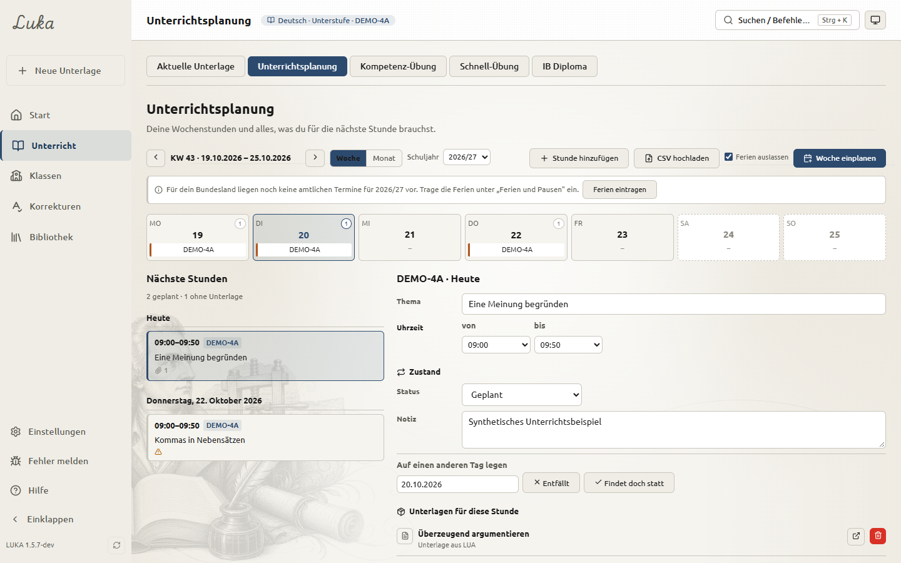
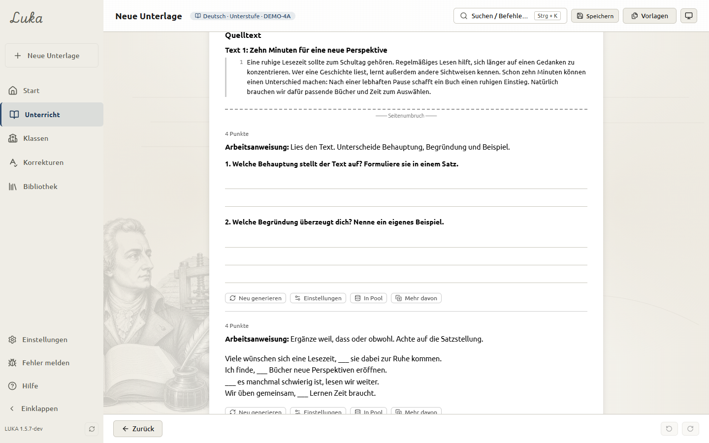
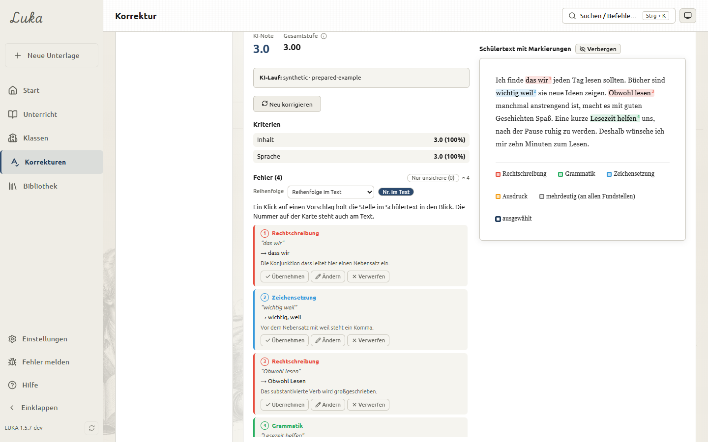
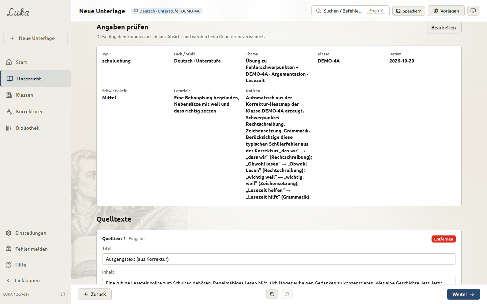
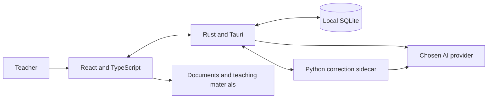

<div align="center">

# LUKA

### Prepare a lesson. Review the work. Teach the next step.

A desktop workspace for teachers: create teaching materials, review written submissions,
and turn recurring mistakes into focused practice.

**Your database and documents stay on your device. AI requests send the required content to your chosen provider, using your own API key.**

[Download for Windows](https://github.com/milanradisavljevic/LUKA/releases/latest) · [Try the samples](samples/) · [User guide — German](docs/ANLEITUNG.md)



*A lesson is the starting point: keep the class, topic and teaching material together.*

</div>

## One lesson, one connected workflow

Imagine a German lesson on writing a convincing argument. You prepare an exercise,
review the class's written responses, and notice that conjunctions and comma placement
need more work. LUKA connects those steps:

1. **Prepare:** choose a lesson in your timetable, bring your own source text or start from a topic, and assemble suitable tasks.
2. **Review:** check the generated worksheet, adjust individual tasks, and export a student version with solutions and optional assessment material.
3. **Correct:** analyse submissions against a rubric, inspect suggested corrections in context, and record your own feedback and grade.
4. **Practise:** use the correction findings to prepare a follow-up exercise for the class or an individual learner.

The teacher reviews the material and assessment suggestions. AI output is a starting point for that judgement.

### From a worksheet to the next exercise



*Inspect the worksheet before export. Tasks remain editable; you can regenerate individual blocks.*



*Read suggested corrections alongside the original text, then make your own assessment.*



*Carry the findings into focused practice instead of starting the next worksheet from scratch.*

> **About these images:** captured from the current development UI on 20 October 2026.
> All classes, texts, documents and correction results are prepared synthetic examples.
> The capture harness supplies desktop-service responses; these images do not demonstrate
> a live AI run or an installed-app acceptance test. The interface is currently German.
> [Image details](screenshots/README.md).

## What you can work with

| Your task | LUKA provides |
|---|---|
| Plan teaching | Weekly lesson patterns, individual lessons, linked materials and school-holiday information with sources. |
| Create materials | Source-based, topic-based and curriculum-based exercises; reusable task blocks and subject packages. |
| Adapt a worksheet | Different task types, difficulty settings, lighter/harder variants and editable previews. |
| Review written work | Rubric context, suggested corrections, teacher feedback, class summaries and learner histories. |
| Plan follow-up practice | Exercises informed by recurring errors and selected learning needs. |
| Take the result elsewhere | DOCX student and solution versions, feedback documents, Moodle/GIFT, and PDF through LibreOffice where configured. |

Materials cover languages and selected humanities subjects. Task types include gap fills,
multiple choice, matching, comprehension, writing, error correction and role cards.
Coverage and suitability vary by subject, curriculum and task type; check the result before use.

## Start using LUKA

### Windows

1. Open the [latest release](https://github.com/milanradisavljevic/LUKA/releases/latest) and download the `*_x64-setup.exe` installer.
2. Install LUKA. The installer is not Windows certificate-signed, so SmartScreen may show a warning. Check the download source before deciding whether to continue.
3. Choose an AI provider in the first-run setup, enter your own API key and test the connection. Provider usage may incur charges.
4. Try the [synthetic sample submissions](samples/README.md) before using your own classroom material.

**Published baseline:** [v1.5.8 Windows x64 installer](https://github.com/milanradisavljevic/LUKA/releases/tag/v1.5.8), released on 21 October 2026. Windows x64 is the supported desktop target. Other platforms are outside the current delivery scope.

LUKA checks for updates and asks before installation. Signed updater artifacts are separate
from Windows certificate signing.

The [user guide](docs/ANLEITUNG.md) and in-app help explain the workflow in German.

### Run from source

Use Node.js 20 or newer, pnpm, a stable Rust toolchain and the
[Tauri platform prerequisites](https://tauri.app/start/prerequisites/).
Windows needs the MSVC build tools and WebView2.

```bash
git clone https://github.com/milanradisavljevic/LUKA.git
cd LUKA/apps/lua
pnpm install --frozen-lockfile
pnpm --filter "./packages/*" build
pnpm tauri:dev
```

Build the workspace packages first: the web app resolves their generated `dist` files.
For correction in a source checkout, use Python 3.11+ and install the correction core
in its own environment (Windows PowerShell, starting from the repository root):

```powershell
cd apps/natascha
python -m venv .venv
.\.venv\Scripts\python.exe -m pip install -e .
```

In LUKA's advanced settings, select that Python executable and the `apps/natascha`
directory if automatic detection does not find them. A release installer bundles the
correction sidecar. The Vite browser preview alone does not provide desktop correction
or file-system commands. See [development notes](AGENTS.md) for the verification commands.

## Data and control

- **Stored locally:** classes, submissions, assessments and other app records in SQLite; exported files in the folder you choose.
- **Sent for AI requests:** the text, task context or supported document content needed by the selected operation goes to the selected provider. A local database does not make AI processing local.
- **Names:** recognised class-list names can be replaced with stable aliases for supported text submissions. PDF and image content is not automatically redacted. This is not complete anonymisation.
- **Credentials:** desktop API keys use the operating-system credential store, with a local `.env.local` fallback where the keyring is unavailable.
- **Optional network activity:** update checks and a bug-report form. Bug reports send the description and optional contact/technical information you choose, rather than automatically attaching classroom documents.
- **Backups:** database exports are unencrypted copies. Saving one to a synced folder can transfer it through that folder's cloud service.

Use synthetic or appropriately pseudonymised material when trying the app. Your school
must determine which provider and processing arrangement is appropriate.
Read the [data-flow and privacy notes — German](docs/DATENSCHUTZ.md) before classroom use.

## How it fits together



The desktop app combines a TypeScript workspace for document schemas, input, rendering,
export and quality checks with a Rust backend. The Python correction core remains
independently usable. The shared database connects teaching materials, assessments
and follow-up work.

## Project status

**Independent open-source project by Milan Radisavljević.** It brings process design,
document generation and practical AI integration together around a teacher's workflow.

The screenshots describe the current development checkout, which includes changes beyond
the latest verified release. See the [changelog](CHANGELOG.md) for released versions and
unreleased additions. Technical checks do not establish pedagogical quality, teacher
acceptance or successful installation on every supported system.

Current priorities are confirmed teacher findings, consistent assessment profiles, teacher feedback and installed-app testing with synthetic data. English SRDP B1/B2 profiles use their own 0–10 scale; automatic grade suggestions require a teacher-confirmed individual grading key. The new profiles remain subject to specialist teacher acceptance. Microsoft 365 integration is planned; the current main application does not provide a live school connection. AI-generated tasks, corrections
and grades need teacher review. OCR and document import have format-dependent limits.

## License

[MIT](LICENSE) · © 2026 Milan Radisavljević.
